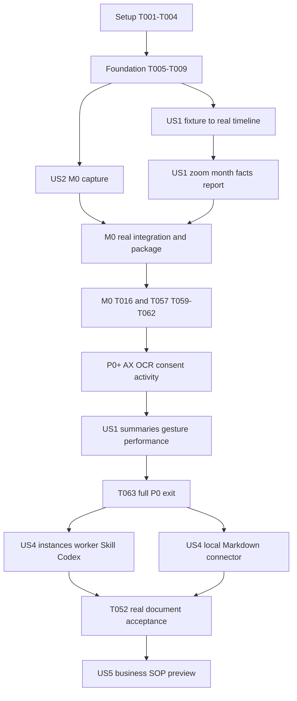

# Tasks: 时间分配一目了然与可复用 SOP

**Input**：[plan.md](/Users/huangzhidong/work/one-room/tianmu-hackthon-15/specs/001-event-driven-capture/plan.md)、[spec.md](/Users/huangzhidong/work/one-room/tianmu-hackthon-15/specs/001-event-driven-capture/spec.md)、[data-model.md](/Users/huangzhidong/work/one-room/tianmu-hackthon-15/specs/001-event-driven-capture/data-model.md)、[contracts](/Users/huangzhidong/work/one-room/tianmu-hackthon-15/specs/001-event-driven-capture/contracts/desktop-ipc.md)、[research.md](/Users/huangzhidong/work/one-room/tianmu-hackthon-15/specs/001-event-driven-capture/research.md)、[quickstart.md](/Users/huangzhidong/work/one-room/tianmu-hackthon-15/specs/001-event-driven-capture/quickstart.md)。

**截止**：2026-10-16 23:59，Asia/Shanghai。任务生成于10-15晚间。只计算两位工程师，不假定另有全职PMO。**已进入基座实施，仅依据实际实现/验证勾选；部分交付另记。**

**本轮范围更新**：用户要求先实现供两人并行的基座，允许直接适配MemoryLane GPL代码，保留来源和许可；测试集中启动、持久化、接口和核心链路，全面边界/两机验收留后续。交接见 [DEVELOPMENT_HANDOFF.md](/Users/huangzhidong/work/one-room/tianmu-hackthon-15/docs/DEVELOPMENT_HANDOFF.md)。

**实施进度（2026-10-15 历史记录）**：基座 T001/T002/T003/T005/T006/T007/T008，以及 A 的 T004/T010–T013/T017–T021/T064 已实现并通过对应核心检查。真实 Swift→截图先存→AX/OCR→活动→暂停重启链路在单机自建窗口通过；T014/T015/T022/T023 的代码或部分检查已交付，完整场景矩阵仍待验，保持未勾选。T009 的 fixture 已交付，G2/G3 和两机门槛未过。B 的 T024–T029/T031–T033 已完成实现与核心检查；生产 reader、报告/删除存储已接入。T057 来源随包检查通过，候选包本机启动/SQLite/helper/凭据加密通过；T059 的正式签名、公证和第二机门槛仍未完成。结果见 [gates.md](/Users/huangzhidong/work/one-room/tianmu-hackthon-15/docs/acceptance/gates.md) 和 [WORKLOG_B_HANDOFF.md](/Users/huangzhidong/work/one-room/tianmu-hackthon-15/docs/WORKLOG_B_HANDOFF.md)。受控窗口成功不代替普通桌面和双机验收，M0/P0 尚未完成。

**整合更新（2026-10-16）**：T025/T028/T033 已完成生产 worker/main/preload 接入及核心检查；T030 的 schema 5 新增持久分块/归并总结、授权双验、报告失效和删除清理，见period-summary.md。schema 4 保留同分支远程提交的可注册发现、候选/Skill/策略预览表和工作台；其Codex直接写入实现缺少当前契约的synthetic gate/冻结输入/精确diff审核，生产run/verify返回 `CAPABILITY_BLOCKED`，不据此勾选T037–T052。当前12文件49项单测、四组Electron/SQLite smoke及8/8 E2E通过，生产非空日月/报告/重启/删除已覆盖。T035完整界面基准在M4 Pro/24GiB通过：游标p95=46.81ms、日/月切层p95=142.05ms，详见navigation-performance.md。T034接原生swipe通道与作用域，物理三指仍未验。普通桌面/两机采集与四类真实语义仍未完成，详见capture.md和T036；constitution未批准模板检查为N/A。从零实现继续在 `001-event-driven-capture` 按验证后的功能提交；远程 `ml-one-room` 为另一套 MemoryLane 基线，未合并或覆盖。

## 交付范围与预算

| 队列 | 范围与退出条件 | 时间安排 |
| --- | --- | --- |
| M0，赛前硬目标 | 独立Electron包；真实获准前台窗口事件/截图落库；真实时长日轴、带文字游标、截图及gap；日期/缩放/月格与事实日报周报；暂停/排除/删除/30天图片到期/重启回看；两机安装及真实演示 | 29项，约20.25人时的乐观预算，含局部验证、打包及材料；另留3.75人时故障余量。原生/签名门槛受阻可能超时，不保证未测能力一定可用 |
| P0+，M0后优先补齐 | AX→OCR、通用事件、模型配置/安全凭证、四类周期对象/主题及模型总结、手势专项、全量性能/覆盖验收 | 15项，另约13–22人时，含T064约1–2人时；M0稳定后按剩余预算领取，18:00后停止新增。缺项仍标完整P0未完成 |
| P1，后续文档闭环 | 逻辑实例→可注册worker→三类文档候选→Skill→Codex输入确认→提案→diff确认→应用核验 | 16项，另约34–52人时，安排比赛后；完整P0验收后推进产品交付 |
| P2，后续业务预览 | 三个有序实例的配券/策略SOP、参数/审批点、草稿/导出/预览 | 4项，另约8–14人时；不产生真实业务写入 |

共64项：M0 29项、P0+ 15项、P1 16项、P2 4项。新增T064保留原有任务编号；仅依据实际实现和对应检查更新完成状态。

M0标签如实显示时间、软件、窗口/可观察对象；无正文依据时对象/主题明确未知，无模型时总结显示未授权/待处理。M0是可使用的时间记忆首版，**不等于US1/US2/US3或完整P0验收通过**。事实报告不是已理解语义的AI日报；尚未实现的入口不得假成功。保留完整spec，范围不足写入实际验收矩阵。

估时假设可借助编码代理、成熟依赖和两台目标Mac；每人今晚约3小时、明日约9小时有效实施/验收预算，不按通宵排。A的M0约9.75h、B约10.5h，另各余2.25h/1.5h缓冲。首小时门槛失败优先消耗缓冲，P0+后移；估时不是工期承诺。

## 执行格式与所有权

- 任务格式为 `- [ ] Tnnn [P?] [USn?] 描述及绝对目标路径`。owner、队列、依赖写在描述中；`[P]`表示前置满足后可与另一工程师做不同文件，不表示跳过依赖。
- 按功能闭环负责，包含各自服务、界面及核心验证：A负责记录/识别（原生捕获、AX/OCR、活动事件、模型配置与队列）及后续执行（文档connector、Codex、输入/diff审核）；B负责时间回顾（周期、查询、时间线/月历/报告/总结）及后续实例/发现/Skill。
- A单写package/lockfile、main注册与迁移入口；B单写shared schema，A审查。服务导出注册函数由A接main；B不直接操作SQLite连接。A的EventReview/ModelSettings/AgentSettings/RunReview为明确文件归属，不因其位于renderer而转给B；测试按功能拆文件，不双写总入口。
- 表按故事分迁移：M0只建使用中的事实/证据/周期/来源/设置及变更日志；后续加文本、实例/发现和执行表。接口类型提前冻结，不先做完全部后端才出现画面。
- 测试任务来自spec的SC验收与契约，聚焦错配/权限/迟到/到期/事务/主界面；不要求全项目TDD，不生成镜像实现的测试。
- 所列文件为实施目标；M0领取表决定赛前顺序，不按文档一路做到P2。基座允许A继续原生捕获、B使用隔离fixture继续时间线，不把尚未完成的真机验收当通过。

## 外部实现复用

Screenpipe锁定 `v2.2.243 / 1b3e4186ec5a624b95a581c7187c1d48284bea9a`，MIT（不含ee/）。四个TS源文件均在 [source-lock.json](/Users/huangzhidong/work/one-room/tianmu-hackthon-15/specs/001-event-driven-capture/source-lock.json)，不重新研究最新版。

| 编号/任务 | 固定源码与最小范围 | 适配及验收 |
| --- | --- | --- |
| R1 / T026 | [use-frame-loading.ts L314–351、L466–502](https://github.com/screenpipe/screenpipe/blob/1b3e4186ec5a624b95a581c7187c1d48284bea9a/apps/screenpipe-app-tauri/components/rewind/hooks/use-frame-loading.ts#L314)，Image预载/取消/contain布局 | `use-evidence-image.ts`、`use-contained-image-layout.ts`，约80–140行适配；改evidence ID协议/generation/requestToken和错误处理；gap/过期/删除立即清图 |
| R2 / T027 | [timeline-controls.tsx L145–173、L187–252](https://github.com/screenpipe/screenpipe/blob/1b3e4186ec5a624b95a581c7187c1d48284bea9a/apps/screenpipe-app-tauri/components/rewind/timeline/timeline-controls.tsx#L145)，日期控制骨架 | `TimelineControls.tsx`，约80–130行；props替代store，上海日期/现成图标；去Tauri/设备/日志依赖 |
| R3 / T031 | [use-scroll-zoom.ts L56–85、L101–119](https://github.com/screenpipe/screenpipe/blob/1b3e4186ec5a624b95a581c7187c1d48284bea9a/apps/screenpipe-app-tauri/components/rewind/hooks/use-scroll-zoom.ts#L56)，React/RAF平滑缩放 | `use-smooth-zoom.ts`，约50–90行；真实时间锚点/日月滞回/单一事件入口，卸载取消RAF；真实三指另验 |
| R4 / T024 | [timeline.tsx L619–706](https://github.com/screenpipe/screenpipe/blob/1b3e4186ec5a624b95a581c7187c1d48284bea9a/apps/screenpipe-app-tauri/components/rewind/timeline/timeline.tsx#L619)，连续run累积/flush结构 | `group-period-runs.ts`，约60–100行；改Period/Gap和对象/主题边界，去Unknown沿用前app；真实时间计宽，A→短Kim→A保留三段 |
| R5 / T012、T014、T017–T019 | [SP-1/SP-2摘录](/Users/huangzhidong/work/one-room/tianmu-hackthon-15/specs/001-event-driven-capture/code-excerpts.md)：事件合并/检查点、薄正文补OCR；AX限额另见固定提交的 [tree/mod.rs L217–255](https://github.com/screenpipe/screenpipe/blob/1b3e4186ec5a624b95a581c7187c1d48284bea9a/crates/screenpipe-a11y/src/tree/mod.rs#L217)、[tree/macos.rs L432–445及L494–504](https://github.com/screenpipe/screenpipe/blob/1b3e4186ec5a624b95a581c7187c1d48284bea9a/crates/screenpipe-a11y/src/tree/macos.rs#L432) | TS调度及小型Swift适配；不引Rust crate；输入仅时序元数据，参数参考后实测 |
| R6 / T004、T010–T013、T019、T040–T041 | MemoryLane `v1.5.10 / f3157d54524e647d32f7decd186ee00cac9f72d5` 的native-screenshot、app-watcher、pipeline-harness、event-capturer、run-detection | 优先直接适配可解耦源码，已用于原生窗口查询和helper进程通信，GPL声明随源保留；按既有契约先落事实。保留短活动和30天图，不采用模型后才落盘的顺序 |
| R7 / T001、T006、T031、T048–T050 | electron-vite / electron-builder / better-sqlite3 / React / Zod / diff / Lucide及Apple系统框架 | 从各自正式包使用构建、DB、校验、差异和图标能力，版本按plan锁定并补实际许可 |

R1–R4合计约270–460行候选适配，不是行数指标；四块已按第三方声明中的实际范围迁入。迁入时保留来源/声明，记录范围、目标、改动和核心验证；某块超过45分钟仍无法解耦则停止扩大复制，保留已取的小块并按接口完成该功能。排除整个Next/Tauri页面、3030服务、视频/音频、Pi、遥测、多设备和第二套DB。用户已授权自用项目适配MemoryLane源码，保留GPL原文及声明，不再受“仅架构参考”限制。

## Phase 1：Setup

目标：可启动工程和共享输入，M0预算2.0h。

- [X] T001 创建固定版本Electron/React/TS工程及lockfile，在 `/Users/huangzhidong/work/one-room/tianmu-hackthon-15/package.json` 建dev/typecheck/lint、按需test及package:mac脚本，先启动空壳；A，M0，0.5h。
- [X] T002 [P] 在 `/Users/huangzhidong/work/one-room/tianmu-hackthon-15/scripts/verify-upstream.mjs` 按source-lock从本地或固定commit取源，校验SHA256/行数/摘录/MIT声明并输出可重复结果；B，M0，0.5h，无工程搭建依赖。
- [X] T003 [P] 在 `/Users/huangzhidong/work/one-room/tianmu-hackthon-15/src/shared/schemas.ts` 落实Zod DTO/错误信封/Native v1/revision/generation/来源状态，提前固定后续instance/worker/run边界及fixture接口；B，M0，0.5h，依赖T001。
- [X] T004 [P] 在 `/Users/huangzhidong/work/one-room/tianmu-hackthon-15/scripts/native-build.mjs` 建Swift5/macOS14 arm64 helper构建、ASAR外资源/嵌套签名配置及最小前台窗口截图预检程序；A，M0，0.5h，依赖T001，采用R6/R7架构和官方API。受控自建窗口真实预检/截图通过，正式签名与两机验收见T059。

## Phase 2：Foundational

目标：安全main、真实存储和fixture边界，M0预算3.25h。本阶段完成才开始故事正式实现；预检不是完整采集器。

- [X] T005 [P] 在 `/Users/huangzhidong/work/one-room/tianmu-hackthon-15/src/main/ipc.ts` 建白名单注册、可信sender/主frame/payload校验、preload领域API及stream重连；禁renderer Node/路径/SQL/进程权限，完成安全窗口；A，M0，0.5h，依赖T003。
- [X] T006 在 `/Users/huangzhidong/work/one-room/tianmu-hackthon-15/src/workers/database.ts` 建单连接SQLite worker、FULL/WAL/FK、首版迁移/checksum/backup及M0表/命令，事实/sourceRefs/domain_changes同事务；迁移失败保留原库并阻断写；A，M0，1.0h，依赖T003、T005。
- [X] T007 在 `/Users/huangzhidong/work/one-room/tianmu-hackthon-15/src/services/evidence/store.ts` 实现图先落盘再提交引用、hash blob复用/每blob锁、独立30天expiresAt、读时到期拒绝、幂等清理/孤儿恢复；受控协议按evidence ID验有效性；A，M0，0.75h，依赖T006。
- [X] T008 [P] 在 `/Users/huangzhidong/work/one-room/tianmu-hackthon-15/src/renderer/settings/CaptureSettings.tsx` 接获准/排除应用、各权限状态、开关及最近成功时间；文字模型默认off，分析未实现时禁用且本地回看可用；B，M0，0.5h，依赖T003、T005，持久命令由A经T006注册。
- [ ] T009 [P] 在 `/Users/huangzhidong/work/one-room/tianmu-hackthon-15/tests/fixtures/worklog-fixtures.ts` 建隔离测试库/renderer adapter，含A→10秒Kim→A、gap、过期/迟到图；在 `/Users/huangzhidong/work/one-room/tianmu-hackthon-15/docs/acceptance/gates.md` 记录G1/G2真实预检和G3限时原始信号，fixture显式标注；B主录、A提供原生结果，M0，0.5h，依赖T004–T006。

**检查点**：G1/G2须有真实结果，资产存在不算ABI通过；指定窗口仍验可见性/TCC。G3探查限20分钟，受阻登记；G4留P1。签名/公证条件不足可保留受控开发演示包，但FR-017的正式安装要求仍未通过，不能声称完整交付。

## Phase 3：US2 在工作切换后找回真实画面（P0）

同为P0，按采集→文本→回顾数据依赖排列US2/US3/US1，保留原故事编号。

**独立验证**：不启模型/Agent，两机各≥60分钟/20次保持≥5秒切换，19/20在3秒内正确留证据；暂停/锁屏/睡眠/权限/排除/重启各3次且gap不串图（SC-001/003）。缺输入/视觉补采则US2保持部分完成。

- [X] T010 [US2] 在 `/Users/huangzhidong/work/one-room/tianmu-hackthon-15/native/WindowListener.swift` 实现初始前台、NSWorkspace激活/AX窗口标题通知、JSONL v1心跳/能力/session身份；排除时仅报停止所需信息；A，M0，1.0h，依赖Phase2，参考R6。
- [X] T011 [US2] 在 `/Users/huangzhidong/work/one-room/tianmu-hackthon-15/native/WindowCapture.swift` 封装SCScreenshotManager指定窗口请求，前后核对pid/window/generation及可见范围，遮挡/屏外/最小化/不确定丢弃并gap；仅staging token、无全屏回退；A，M0，1.5h，依赖T010。当前本机覆盖层使普通桌面窗口被严格拒绝，限制见capture.md。
- [X] T012 [US2] 在 `/Users/huangzhidong/work/one-room/tianmu-hackthon-15/src/services/capture/coordinator.ts` 实现helper client、有界队列/重试/超时、窗口事件和标记的静态/降级检查点；先提交图/事实，同图仍保留观察时间、溢出有gap；A，M0，0.75h，依赖T007、T010、T011，采用R5/R6。
- [X] T013 [US2] 在 `/Users/huangzhidong/work/one-room/tianmu-hackthon-15/src/services/capture/coordinator.ts` 处理pause/resume、锁屏/睡眠/排除/撤权/断流、generation取消/迟到拒收；重启按最后持久检查点关闭旧区间再观察前台；A，M0，0.75h，依赖T012。生命周期集中在coordinator，完整场景验收另见T015/T016。
- [ ] T014 [US2] 在 `/Users/huangzhidong/work/one-room/tianmu-hackthon-15/native/InputTiming.swift` 和 `/Users/huangzhidong/work/one-room/tianmu-hackthon-15/src/services/capture/triggers.ts` 补click/typing_pause/scroll_stop及获准窗口视觉检查，校准R5参数/合并/降级；不读字符/keycode/剪贴板，输入权限不足保留获准检查点；A，P0+，依赖T013。
- [ ] T015 [US2] 在 `/Users/huangzhidong/work/one-room/tianmu-hackthon-15/tests/integration/capture-lifecycle.test.ts` 验错配/旧generation/暂停撤权迟到/溢出/重启gap、共享blob新旧引用/到期前后/重复清理，文字任务不存在仍可看有效图；A，M0，0.75h，依赖T007、T013。
- [ ] T016 [US2] 在 `/Users/huangzhidong/work/one-room/tianmu-hackthon-15/docs/acceptance/capture.md` 保存两机SC-001/003样本/延迟/权限归属，T059包就绪后补齐60分钟；区分真实/fixture及失败；A，M0，0.5h主动操作预算，另需≥1h墙钟，依赖T015、T059，可与B验UI并行。

## Phase 4：US3 尽量读准屏幕上的正文（P0）

**队列**：P0+，M0文本/模型状态如实未知。**独立验证**：20个正文/薄正文/空/超时/混合真值、三应用来源与中文质量，授权五状态；提取失败仍看有效图（SC-002/009/010）。

- [X] T017 [US3] 在 `/Users/huangzhidong/work/one-room/tianmu-hackthon-15/native/AccessibilityText.swift` 实现可终止extract进程的可见AX正文、安全/隐藏节点过滤、节点/深度/文本预算及partial原因，监听不被同步AX阻塞；A，P0+，依赖T011–T013，采用R5。
- [X] T018 [US3] 在 `/Users/huangzhidong/work/one-room/tianmu-hackthon-15/native/VisionOCR.swift` 用同观察有效截图做本地中英Vision OCR，返回完整性/状态/错误；排除或图片失效不能补OCR；A，P0+，依赖T007、T011。
- [X] T019 [US3] 在 `/Users/huangzhidong/work/one-room/tianmu-hackthon-15/src/services/capture/text-pipeline.ts` 及 `/Users/huangzhidong/work/one-room/tianmu-hackthon-15/src/services/storage/capture-migration.ts` 增加分来源文本/FTS，AX完整优先、thin/partial/empty/failed时按授权补OCR；提交重验身份/来源，两来源分存；A，P0+，依赖T017、T018。v2新库及v1升级核心检查通过。
- [X] T020 [P] [US3] 在 `/Users/huangzhidong/work/one-room/tianmu-hackthon-15/src/services/worklog/activity-events.ts` 关联窗口/控件/输入时序和文本，统一view/suspected_edit/context_switch/unknown及basis/sourceRefs，在 `/Users/huangzhidong/work/one-room/tianmu-hackthon-15/src/renderer/timeline/EventReview.tsx` 接人工对象/行为修订并保留原始事实；正文变化不证明编辑/保存；A，P0+，依赖T019、T021、T024，B提供周期DTO。worklog-read按observationId投影活动语义，完整跨应用验收仍见T023。
- [X] T021 [P] [US3] 在 `/Users/huangzhidong/work/one-room/tianmu-hackthon-15/src/workers/model.ts` 实现单并发有界文字模型任务、独立持久授权/范围、派发/提交双验/撤销/迟到丢弃；读取T064的配置与安全凭证，不重复建设配置UI；用成熟SDK或HTTP接口，无截图自动上传，配置缺失保持未授权/待配置；A，P0+，依赖T008、T019、T064。
- [ ] T022 [US3] 在 `/Users/huangzhidong/work/one-room/tianmu-hackthon-15/tests/integration/text-extraction.test.ts` 运行20个标注场景和实际三应用AX/OCR对照，核验status/五种completeness、中文质量、错配及安全排除；A，P0+，依赖T019。
- [ ] T023 [US3] 在 `/Users/huangzhidong/work/one-room/tianmu-hackthon-15/tests/integration/model-consent.test.ts` 验未授权/开启/重启/关闭/缩范围及派发返回竞态，断言未发取消/迟到不落库/截图发送0且本地回看可用；在 `/Users/huangzhidong/work/one-room/tianmu-hackthon-15/tests/integration/activity-events.test.ts` 补SC-009三应用AX/仅OCR路径、活动分类/观察推断确认/未知、用户修订保留原证据；A，P0+，依赖T020、T021。
- [X] T064 [P] [US3] 在 `/Users/huangzhidong/work/one-room/tianmu-hackthon-15/src/services/model/config-store.ts`、`src/services/model/index.ts` 与 `/Users/huangzhidong/work/one-room/tianmu-hackthon-15/src/renderer/settings/ModelSettings.tsx` 实现模型baseUrl/model/API Key配置、系统安全凭证加密保存/清除/重启读取、hasCredential状态及用户触发的合成连接测试；补model.getConfig/saveConfig/testConnection/clearCredential契约与main注册，读接口/日志不返Key或服务原文，测试连接不启用后台文字授权；本地AX/UI树及Vision OCR无需此Key。A，P0+，约1–2h，依赖T003、T005、T006、T008，可先于T019/T021完成，凭证失效/清除后模型任务不得沿用旧配置。

## Phase 5：US1 一眼看清日月时间分配（P0）

**M0目标**：可用日/月事实回顾，不依赖US3完成。**完整独立验证**：SC-004/013/014/015，12个四类周期、10处游标、10次日月往返、100次定位/20次切层及两机真实手势；软件/窗口标签不替代语义总结通过。

**B 整合更新（2026-10-16）**：T024–T033 已实现并接入生产 reader、持久报告/删除及 main/preload；T030 使用schema 5持久总结任务树，T035补齐生产renderer/图片解码/切层基准。T057来源随包检查已通过。8/8 E2E含生产SQLite合成非空历史的日月、报告、重启、删除和旧revision游标恢复；受控真实捕获到报告/删除另经服务检查。T034物理三指、T036四类真实语义/保留矩阵和两机门槛仍待，此处不表示M0或完整US1/P0通过。交接与实际验证见 docs/WORKLOG_B_HANDOFF.md、docs/acceptance/timeline.md。

- [X] T024 [P] [US1] 在 `/Users/huangzhidong/work/one-room/tianmu-hackthon-15/src/services/worklog/periodizer.ts` 实现事实半开周期/gap/跨日投影，在 `/Users/huangzhidong/work/one-room/tianmu-hackthon-15/src/renderer/timeline/group-period-runs.ts` 适配R4；保留短切换，未知不沿用前app，时长取真实区间；B，M0，0.75h，依赖Phase2，先T009数据、T013后接真实源。
- [X] T025 [US1] 在 `/Users/huangzhidong/work/one-room/tianmu-hackthon-15/src/services/worklog/queries.ts` 实现timeline.query/resolveCursor/calendar注册及revision分页，定位带完整筛选/requestToken、不跨gap借图，筛选统计按真实并集；B，M0，0.5h，依赖T024，DB命令由A注册。生产读取、正文FTS/短中文、游标与分页失效已通过核心检查。
- [X] T026 [US1] 在 `/Users/huangzhidong/work/one-room/tianmu-hackthon-15/src/renderer/timeline/TimelineView.tsx` 建画面/真实时间轨道/可拖铆钉及就地完整标签，迁R1两个小hook，补generation/revision校验和gap/删除/过期清图，未知明确、图带observedAt；B，M0，1.25h，依赖T025。
- [X] T027 [US1] 在 `/Users/huangzhidong/work/one-room/tianmu-hackthon-15/src/renderer/timeline/TimelineControls.tsx` 迁R2并接日期/当前/播放/平移/软件筛选和独立助手范围，上海日期/图标tooltip、窄片段可选/放大；B，M0，0.75h，依赖T026。
- [X] T028 [US1] 在 `/Users/huangzhidong/work/one-room/tianmu-hackthon-15/src/services/worklog/history-delete.ts` 及 `/Users/huangzhidong/work/one-room/tianmu-hackthon-15/src/renderer/settings/HistorySettings.tsx` 接删除预览/确认、sourceGeneration、M0正文/快照/FTS清理/投影失效，renderer清解码缓存；后续消费者接同一入口；B，M0，0.75h，依赖T007、T025。预览前持久暂停与队列收敛，事务清理/共享blob/幂等重启及bridge核心检查通过。
- [X] T029 [US1] 在 `/Users/huangzhidong/work/one-room/tianmu-hackthon-15/tests/e2e/timeline.spec.ts` 验迟到图/gap/过期/删除/A→10秒Kim→A/真实宽度/游标标签，保存1440×1000和390×844截图核对无重叠溢出；B，M0，0.5h，依赖T026–T028。
- [X] T030 [US1] 在 `/Users/huangzhidong/work/one-room/tianmu-hackthon-15/src/services/worklog/period-summary.ts` 及 `/Users/huangzhidong/work/one-room/tianmu-hackthon-15/src/services/storage/period-summary-{migration,state,commands}.ts` 接显著对象/主题切换总结队列及schema，四类对象/主题/摘要/来源/basis分开，批处理不覆盖人工锁；同应用切群/人/文档也建边界，会议只写可见信息；B，P0+，依赖T019–T021、T024。schema5持久叶块/归并、主进程队列与HTTP接线已实现；240来源、撤权/重启/锁、报告失效、跨午夜及部分删除重建通过，见docs/acceptance/period-summary.md；真实四类真值质量留T036。
- [X] T031 [US1] 在 `/Users/huangzhidong/work/one-room/tianmu-hackthon-15/src/renderer/timeline/hooks/use-smooth-zoom.ts` 迁R3，并在 `/Users/huangzhidong/work/one-room/tianmu-hackthon-15/src/renderer/timeline/navigation.ts` 接10秒至24小时的锚定缩放/归一化跨层滞回/手势结束锁；短录制自动适配，单入口pinch/修饰wheel/按钮，普通列表滚动保留；B，M0，0.75h，依赖T027。连续跨日导航补充见T067。
- [X] T032 [US1] 在 `/Users/huangzhidong/work/one-room/tianmu-hackthon-15/src/renderer/calendar/MonthView.tsx` 接全天继续缩小入月、反向/选日恢复定位，月格按时序列事实/覆盖及密集滚动、窄窗逐日列表；不批量加载图，未采集日期空；B，M0，0.75h，依赖T025、T031。
- [X] T033 [US1] 在 `/Users/huangzhidong/work/one-room/tianmu-hackthon-15/src/services/worklog/reports.ts` 及 `/Users/huangzhidong/work/one-room/tianmu-hackthon-15/src/renderer/reports/ReportView.tsx` 建完整上海日/周一周报事实投影/snapshot/coverage、月格跳转及无报告生成/目标待配置；不暗用筛选，外部目标单独引用，模型总结后接T030；B，M0，0.5h，依赖T024、T032。schema3持久快照/全部观察来源/回执和同asOf提交已接，重启/删除/失效及UI核心检查通过。
- [ ] T034 [US1] 在 `/Users/huangzhidong/work/one-room/tianmu-hackthon-15/src/renderer/timeline/gesture-adapter.ts` 接BrowserWindow swipe up/down领域事件，限时间线焦点/命中，记录两Mac各≥10次信号/配置到 `/Users/huangzhidong/work/one-room/tianmu-hackthon-15/docs/acceptance/gestures.md`；B，P0+，依赖T031、T032，A接main；备用不算三指通过。
- [X] T035 [US1] 在 `/Users/huangzhidong/work/one-room/tianmu-hackthon-15/scripts/benchmark-navigation.mjs` 和 `/Users/huangzhidong/work/one-room/tianmu-hackthon-15/scripts/benchmark-renderer.mjs` 建隔离30天/100000观察/10000周期/1000blob库，验100次定位/20次切层及p95≤1s/≤2s，记录缓存/机器；补短查询FTS/LIKE及分页失效；B，P0+，依赖T025、T032。服务层定位p95=40.57ms、日/月查询p95=1172.74ms及FTS/短中文/分页失效通过；生产Electron/main/preload/SQLite、1280×720合成PNG协议解码和绘制后，定位p95=46.81ms、日/月切层p95=142.05ms，密集月格刷新/末项精确跳转及390px无溢出通过。完成范围限M4 Pro/24GiB、缓存未清的受控负载；物理三指/两机/真实语义留T034/T036/T063，详见docs/acceptance/navigation-performance.md。
- [ ] T036 [US1] 在 `/Users/huangzhidong/work/one-room/tianmu-hackthon-15/docs/acceptance/timeline.md` 验四类各≥3真值、对象/主题未知对照、同应用切换、月格报告同源、≥10标签与≥10往返；在 `/Users/huangzhidong/work/one-room/tianmu-hackthon-15/tests/integration/retention.test.ts` 补SC-008可控时钟验证30天前后/重复清理，文字/摘要/时分/报告不变、有效文字可选而过期图不可用、原图位置标到期；接真实T030后验语义，不以fixture/原图匹配替代；B，P0+，依赖T022、T030、T033–T035。

## Phase 6：US4 文档 SOP 发现、续接与 Codex 复用（P1）

**队列**：比赛后，完整P0验收后交付。**独立验证**：未注册文件时三类文档各两实例提示，A10→B5→A15计A25/B5且A一次；单次规则可注册/重放抑制不丢；三类Markdown各一真实Codex双确认更新及取消/超时/认证/无效/冲突（SC-005/006/011/012/016）。

- [ ] T037 [US4] 在 `/Users/huangzhidong/work/one-room/tianmu-hackthon-15/src/services/storage/migrations/006-discovery-runs.sql` 增实例/关联修订、worker/findings、targets/skills/UUID版本、runs/proposals/operations/receipts及真实来源join/领域命令，升级不丢M0数据；A，P1，依赖T020、T028、T063。schema 3用于报告/删除，远程schema 4已有部分SOP表，schema 5用于周期总结；补齐契约须新增迁移，不改已应用的checksum。
- [ ] T038 [US4] 在 `/Users/huangzhidong/work/one-room/tianmu-hackthon-15/src/services/worklog/instances.ts` 按对象/业务目标/进展实现active/suspended/completed及A→B→A续接/主要归属唯一；标题/静置/切窗不单独分合或完成；B，P1，依赖T020、T037。
- [ ] T039 [US4] 在 `/Users/huangzhidong/work/one-room/tianmu-hackthon-15/src/renderer/discoveries/InstanceReview.tsx` 接人工续接/合并/拆分及revision、instance.revised/时长/计次重算，保留原观察和待确认身份；B，P1，依赖T038。
- [ ] T040 [US4] 在 `/Users/huangzhidong/work/one-room/tianmu-hackthon-15/src/services/discovery/registry.ts` 接稳定workerId/ruleId/version/definitionHash自注册、订阅/动作白名单和受限context/可终止有界宿主；新单次提示不改采集/时间轴/主分发；B，P1，依赖T037、T038。
- [ ] T041 [US4] 在 `/Users/huangzhidong/work/one-room/tianmu-hackthon-15/src/services/discovery/host.ts` 接domain_changes重放、findings/state/cursor同事务、全部来源/授权/关联revision双验、稳定findingKey/升级alias/抑制保留；失败/禁用隔离，不直接写文档；B，P1，依赖T040。
- [ ] T042 [US4] 在 `/Users/huangzhidong/work/one-room/tianmu-hackthon-15/src/services/discovery/document-update.ts` 注册日报/周报/普通文档两不同疑似更新实例规则，无预注册文件要求，候选含依据；滚动/刷新/协作/同名不同对象不称确认更新；B，P1，依赖T039、T041。
- [ ] T043 [US4] 在 `/Users/huangzhidong/work/one-room/tianmu-hackthon-15/src/renderer/discoveries/DiscoveryList.tsx` 接证据/待确认项/忽略/24h稍后/恢复/接受及worker独立启停故障；kind动作通用，单次提醒不强制Skill；B，P1，依赖T042。
- [ ] T044 [US4] 在 `/Users/huangzhidong/work/one-room/tianmu-hackthon-15/src/services/skills/versions.ts` 及 `/Users/huangzhidong/work/one-room/tianmu-hackthon-15/src/renderer/skills/SkillEditor.tsx` 接候选草稿/实例目标范围确认/UUID不可变版本/SKILL.md和manifest导出；歧义不ready，保存不授权执行；B，P1，依赖T043、T045。
- [X] T045 [P] [US4] 在 `/Users/huangzhidong/work/one-room/tianmu-hackthon-15/src/services/documents/local-markdown.ts` 接系统选择target、先lstat拒symlink再realpath身份、严格UTF8/BOM/换行/≤2MiB、唯一章节字节范围/现文/独占确认；不接renderer任意path；A，P1，依赖T037，可与T038–T043并行。
- [X] T046 [US4] 在 `/Users/huangzhidong/work/one-room/tianmu-hackthon-15/src/services/documents/operations.ts` 接目标串行/批准hash来源复核、范围外原字节/日期唯一、写前intent、临时fsync/rename/目录fsync/重读；before/after/other hash恢复，不盲回滚，非独占导补丁；A，P1，依赖T045。
- [X] T047 [US4] 在 `/Users/huangzhidong/work/one-room/tianmu-hackthon-15/src/services/agents/capability-check.ts` 接Codex0.144.1只读version/auth/help探测及能力矩阵定义，并在 `/Users/huangzhidong/work/one-room/tianmu-hackthon-15/src/renderer/settings/AgentSettings.tsx` 展示安装/版本/认证/能力状态与手动重新检查入口；不复制auth或自动登录，此步不宣称G4通过，失败capability_blocked且业务发送0，Claude可见禁用；A，P1，依赖T037，可与B的T038–T044分支并行。
- [ ] T048 [US4] 在 `/Users/huangzhidong/work/one-room/tianmu-hackthon-15/src/services/agents/codex.ts` 实现固定binary/argv、shell=false、受控目录/minimal env/stdin冻结材料、只读JSONL/大小限制、120s超时/2s终止宽限；用同一adapter执行合成schema/禁额外工具矩阵，结果供T047判定G4，通过前业务发送0，恰一有效Proposal才审核；A，P1，依赖T047。
- [X] T049 [US4] 在 `/Users/huangzhidong/work/one-room/tianmu-hackthon-15/src/services/agents/runs.ts` 接prepare/propose/get/cancel/apply/exportPatch、输入目标规则来源hash/generation/15min批准/作用域幂等；生成审核可取消，applying/verifying返回BUSY继续恢复；A，P1，依赖T044、T046、T048。
- [X] T050 [US4] 在 `/Users/huangzhidong/work/one-room/tianmu-hackthon-15/src/renderer/runs/RunReview.tsx` 展示完整输入及完整diff、两次分别确认、来源版本/实际阶段/故障回执/受控补丁导出；turn.completed或退出0不等于写回成功；A，P1，依赖T049。
- [ ] T051 [US4] 在 `/Users/huangzhidong/work/one-room/tianmu-hackthon-15/tests/integration/document-run.test.ts` 验实例拆合、worker注册/升级/重放/故障/抑制、CLI坏/过大/截断/工具/无提案/取消迟到、BOM/CRLF/重复标题日期/冲突/幂等/rename前后崩溃及来源删除；A写文档/Agent、B写实例/发现并拆独立文件，P1，依赖T039–T050。
- [ ] T052 [US4] 在 `/Users/huangzhidong/work/one-room/tianmu-hackthon-15/docs/acceptance/document-sop.md` 记录三类各一真实发现/确认/复用、同日期重试/普通文档范围外字节与故障，Codex失败不假成功/Claude不运行；A+B，P1，依赖T051及完整P0验收。

## Phase 7：US5 配券与策略 SOP 发现和沉淀（P2）

**独立验证**：三个不同完整有序实例，单次浏览/乱序/跨轮不触发；确认变量/步骤/结果/审批后仅草稿与预览，真实业务请求0（SC-012/016）。

- [ ] T053 [US5] 在 `/Users/huangzhidong/work/one-room/tianmu-hackthon-15/tests/fixtures/coupon-strategy.ts` 定义一类实际SOP的步骤/对象/轮次/结果及未知/只读对照，不把三个孤立步骤当三个实例；B，P2，依赖T052。
- [ ] T054 [US5] 在 `/Users/huangzhidong/work/one-room/tianmu-hackthon-15/src/services/discovery/sop-sequence.ts` 经registry注册三个不同有序实例规则，续接不跨实例拼步骤，复用游标/去重/来源/抑制；B，P2，依赖T053。
- [ ] T055 [US5] 在 `/Users/huangzhidong/work/one-room/tianmu-hackthon-15/src/renderer/skills/SopPreview.tsx` 接参数/审批/步骤确认、草稿版本/导出/预览；禁真实业务connector，证据不足保持未知；B，P2，依赖T054。
- [ ] T056 [US5] 在 `/Users/huangzhidong/work/one-room/tianmu-hackthon-15/tests/integration/sop-preview.test.ts` 验完整三实例/续接不增轮次/只读乱序跨轮负例/重放无重复及真实业务请求0；A审权限、B实现，P2，依赖T055。

## Phase 8：US6 获得可审查的最小复用依据（P2，来源合规随M0前置）

既有24文件研究/3摘录已存在，以下验实际移植/分发，不重做调研。**独立验证**：全部固定源码/hash/许可可追溯，研究/构建/真机/产品层级分开（SC-007）。

- [X] T057 [US6] 在 `/Users/huangzhidong/work/one-room/tianmu-hackthon-15/THIRD_PARTY_NOTICES.md` 和 `/Users/huangzhidong/work/one-room/tianmu-hackthon-15/docs/acceptance/reuse.md` 记实际迁入范围/目标/改动/验证/MIT或GPL及正式依赖许可，运行T002并随包带声明；B，M0，0.25h，依赖T002、T024、T026、T027、T031。A已核对候选包声明与两份许可，见package.md。
- [ ] T058 [US6] 在 `/Users/huangzhidong/work/one-room/tianmu-hackthon-15/docs/acceptance/reuse.md` 补本轮P0+的R5/新增依赖commit/hash/许可/采用层级，新增源文件先扩source-lock再复用，保留原记录；A+B，P0+，依赖T014、T017–T023、T030、T034–T036。T063只核本轮P0+来源；以后每版本增量重跑本项，不等待未来P1/P2，不代表应用验收。

## Phase 9：Polish 与交付

M0交付不等P0+/P1/P2，最后T063才负责完整P0退出。

- [ ] T059 在 `/Users/huangzhidong/work/one-room/tianmu-hackthon-15/electron-builder.yml` 完成arm64包、实际Electron ABI SQLite/FTS5、helper ASAR外路径/权限/嵌套签名及可用公证验证、第二台安装重启；记录 `/Users/huangzhidong/work/one-room/tianmu-hackthon-15/docs/acceptance/package.md`；A，M0，0.75h，依赖T013、T015、T028、T032、T033、T057。schema 5本机包已重建，package-smoke通过启动/报告/删除回执/safeStorage/helper/许可检查，同包SOP工作台检查通过；源码版本和hash见package.md，正式签名、公证与第二台安装仍待。
- [ ] T060 在 `/Users/huangzhidong/work/one-room/tianmu-hackthon-15/tests/e2e/m0-worklog.spec.ts` 串真实采集→游标→月格→事实报告→pause gap→重启及删除到期，配合T016双机运行；记录M0通过项和原SC缺项；B，M0，0.5h主动操作预算，依赖T029、T032、T033、T059。
- [ ] T061 在 `/Users/huangzhidong/work/one-room/tianmu-hackthon-15/docs/acceptance/submission.md` 准备安装入口/版本hash、匿名60–90秒真实视频、项目卡/依赖与AI披露/限制，素材存 `/Users/huangzhidong/work/one-room/tianmu-hackthon-15/artifacts/submission/`，用户原图不入Git；B，M0，0.75h，依赖T016、T057、T059、T060，外部提交按比赛流程。
- [ ] T062 在 `/Users/huangzhidong/work/one-room/tianmu-hackthon-15/docs/acceptance/release-check.md` 执行18:00冻结/23:00交付检查、typecheck/lint/已实现测试及阻断修复后受影响回归/重建同候选包，列未完成/受阻、预留提交余量；A+B，M0，1.0人时（各0.5h），依赖T016、T059–T061。
- [ ] T063 在 `/Users/huangzhidong/work/one-room/tianmu-hackthon-15/docs/acceptance/p0-matrix.md` 汇总T014/T022/T023/T034–T036、T058本轮来源和M0证据，逐项确认完整P0采集/中文/活动修订/授权/语义/手势/性能/保留删除/安装；失败派修复并保留未完成，通过P0退出才转P1；A+B，P0+，依赖T014、T017–T023、T030、T034–T036、T058、T062。

## 依赖与领取顺序

图表示交付依赖；M0稳定后可领取P0+，不必等视频完成。T016等T059包，T059不等T016，避免验收与打包互等。T057是发包前来源检查，不能因US6为P2而推迟。

| 批次 | A | B | 交接/限制 |
| --- | --- | --- | --- |
| 1 | T001 | T002 | 固定版本和source-lock |
| 2 | T004 | T003 | T001完成，共享schema B单写 |
| 3 | T005→T006→T007 | T008→T009 | B等待各项明示前置，Foundation退出才开故事 |
| 4 | T010→T011→T012→T013→T015 | T024→T025→T026→T027→T028→T029 | native/UI并行，T013后必须接真实源 |
| 5 | 原生阻断修复/包准备 | T031→T032→T033→T057 | A不另做时间线，B不转Codex替代P0 |
| 6 | T059→T016 | T060→T061 | 先包后双机各60min，B同时验UI |
| 7 | T062及受影响回归 | T062及材料 | 封M0，缓冲用于修复 |
| 8，M0稳定后 | T064；T014→T017→T018→T019→T021→T020→T022→T023 | 完成M0材料后，T030→T034→T035→T036 | T064只等基座，可先做；T020还等B的T024，T030等A的T020/T021；补T058后T063 |
| 9，P0通过后 | T037→T045→T046→T047→T048，再T049→T050及文档/Agent回归 | T038→T039→T040→T041→T042→T043→T044及实例/发现回归 | T044等T045，T049等B的T044及A的T046/T048；T051→T052汇合 |
| 10 | 文件/权限回归及零业务写入审核 | T053→T054→T055→T056 | P2在P1验收后领取 |

以上为领取顺序，T021须等T019/T064；T064可在T019之前独立完成，连接成功不等于文字发送授权。前置满足时独立分支可在另一方未完成故事内推进。迁移/main注册由A领取，B提供领域命令模块，避免冲突。

## 每个故事的并行示例

| 故事 | 同时开展 | 前置/限制 |
| --- | --- | --- |
| US1 | B的T024/T026时间线；A的US2 T010/T011供数 | Foundation完成，fixture只供开发，正式须真实源 |
| US2 | A的T012/T013采集；B的US1 T025/T028查询失效UI | T007/协议冻结，main/DB由A合并 |
| US3 | A的T064配置或T017–T023记录识别；B的T024–T029时间回顾 | 配置只等基座；提取/模型/活动按各自依赖，B先fixture后真实源，T030才汇合语义 |
| US4 | A的T045–T048文档/Codex；B的T038–T044实例发现/Skill | T037完成，T044等T045，T049前汇合G4/Skill/文件事务，不把A内部任务视作人力并行 |
| US5 | B的T054规则；A按T053审核请求拦截 | T053冻结，一个实现owner，T056集成 |
| US6 | B的T057迁入追踪；A核对T059包内声明 | 对应迁入完成，复用T002校验结果 |

## 比赛时钟与止损

以下均Asia/Shanghai，表示可选墙钟窗口，不是每人连续值守表。明日各窗口合13小时，每人仅领取其中9个有效小时：09:00–18:00安排6小时实施，18:00–23:00安排3小时验收/材料/故障缓冲，其余轮换休息或等待自动运行；有效工时不得重复累计。真实60min采集只计主动操作时间，但墙钟须保留。实际晚开工时减少P0+领取，不压缩休息和验收。

| 窗口 | A | B | 退出/止损 |
| --- | --- | --- | --- |
| 10-15 20:30–21:30 | 工程/ABI/helper最小包/截图预检 | 固定复用/schema/fixture | 尽早发现签名、第二台、TCC/可见性阻断 |
| 21:30–23:30 | IPC/DB/证据、事件起步 | 设置/最小时间线adapter | 当晚有可启动包/DB及门槛结果，未成闭环明确剩余 |
| 10-16 09:00–12:00 | 真实截图/持久化/gap | 日轴游标/真实证据接入 | 争取中午共同基座；无真实采集回看则停止领取扩展 |
| 13:00–16:00 | 生命周期/删除到期配合/包 | 日期/缩放/月格/事实报告 | 补M0，不为SOP开新链 |
| 16:00–18:00 | 第二台候选包/阻断修复 | M0回归/来源声明 | 只领取冻结前可独立验完的P0+小项 |
| 18:00–21:00 | 候选包/双机60min/恢复 | UI回归/真实视频/披露 | 功能冻结，只修阻断；签名/三指受阻如实记 |
| 21:00–23:00 | 修复回归/版本包hash | 演示材料/提交准备 | 23:00前齐本地交付和限制矩阵，23:59截止 |

三项止损：可见性无法证明则不存该图文；P0未过则SOP/Codex后续；权限/来源/文件保护不得为截止省略。M0也超预算时保留实证可运行部分及缺项，不把缩范围结果改称完整P0通过。

## 连续录制轨道补充

- [X] T067 [US1] 参考固定 Screenpipe 的 wheel/当前帧和居中时间带实现：全局真实录制边界、短录制自动缩放、最新位置定位、跨午夜滚动/拖动/播放、前后一天缓冲、截图联动与独立日统计；覆盖 FR-028。时间线9项及生产SQLite2项界面检查通过，包含三分钟跨午夜轨道和双向截图像素变化；存储检查覆盖跨查询范围、截图到期和主动删除。物理双指手感与 T034 双机三指另验，见 docs/acceptance/timeline.md。

## 覆盖与完成判断

2026-10-16 用户追加的回顾体验，按功能独立提交：

- [X] T065 [US1] 连续滚轮/触控板时间平移、居中游标、截图查询合并与有效证据保留，日/月淡出后撤和淡入进入动画；保留列表滚动、缺口清图与 reduced-motion。覆盖 FR-026；合成事件验证不替代 T034 双 Mac 物理三指。
- [X] T066 [US1] 独立于外部文档的日报/周报回顾：时间分配、节奏、关键进展/时刻、事实明细、审阅后导出无远程资源的独立 HTML；仅使用现有有效快照，区分观察/推断/人工确认，不凭时长推断成果。覆盖 FR-027；核心衍生、转义、删除失效和桌面/窄屏流程验证。

T045–T050 的勾选表示本地 Markdown、受限 Agent 协议、审核和持久事务的实现与受控测试完成。T048 保持未完成：生产 Codex CLI 尚无可信的外部工具隔离验证器，G4 阻断；T037 的实例/worker 部分及 T051 的 B 侧矩阵也仍待。T065 最终录制范围版的界面基准含动画完成：游标 p95 99.04ms，日/月 p95 442.27ms；T066 的 8 项报告单测覆盖真实报告裁剪链，不将午夜边界编造成夜间时刻。最新完整检查为 95 项单测、六组 SQLite 集成与 13 项 E2E 通过，另 1 项外部 workflow runtime 检查跳过。详见 `docs/acceptance/`，不代表完整 P0 或真实业务进展质量验收通过。

| 故事/横切 | 任务 | 需求 | 完整独立验收 |
| --- | --- | --- | --- |
| US1 | T024–T036 | FR-008、FR-009、FR-010、FR-011、FR-023、FR-024 | SC-004、SC-013、SC-014、SC-015；M0事实界面，语义/性能/三指另验 |
| US2 | T010–T016 | FR-001、FR-002、FR-004、FR-005、FR-006、FR-007 | SC-001、SC-003；输入/视觉补采由T014补齐 |
| US3 | T017–T023、T064 | FR-003、FR-018、FR-019 | SC-002、SC-009、SC-010；配置/凭证与文字授权分开 |
| US4 | T037–T052 | FR-012、FR-013、FR-014、FR-020、FR-021、FR-022、FR-025 | SC-005、SC-006、SC-011、SC-012文档扩展、SC-016文档 |
| US5 | T053–T056 | FR-021、FR-025 | SC-012业务、SC-016零业务写入 |
| US6 | T002、T057、T058 | FR-016 | SC-007 |
| 保留/删除/安装 | T006/T007/T015/T028/T036/T059–T063 | FR-015、FR-017 | SC-008；M0图片边界、P0+文字/摘要保留、主动删除分测 |

完成须有真实代码/产物、对应验证及owner交接，单任务完成不等于全故事完成。M0的29项及T062通过才称最小首版交付，完整P0须T063；再依次确认P1/P2，保留原规格失败/受阻/未执行项。
